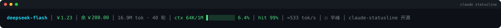

### Hi 👋

I build small tools. Mostly Python, mostly things I got tired of doing by hand.

[claude-statusline](https://github.com/yanghaod2278827/claude-statusline) — a cost-aware status line for Claude Code running on a third-party Anthropic-compatible API.

`Python` · `PyTorch` · `COMSOL` · `MATLAB`
